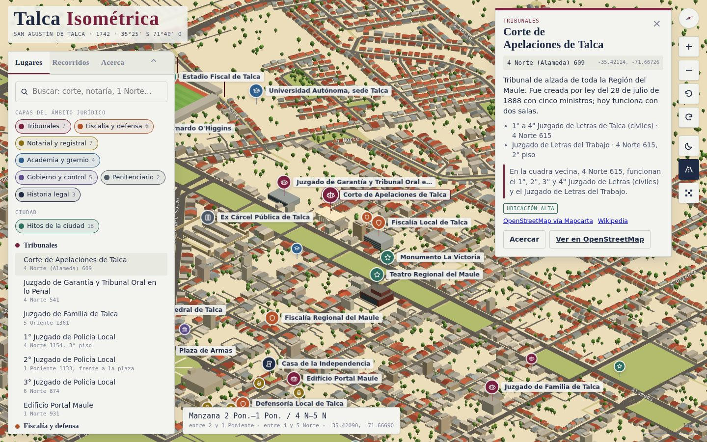

# Talca Isométrica

Maqueta isométrica interactiva de Talca (Región del Maule, Chile) que destaca los lugares del ámbito jurídico (tribunales, fiscalías, defensorías, notarías, registros, academia y la historia legal de la ciudad) junto a sus hitos urbanos. Cubre toda la comuna de Talca (232 km²), recortada por su límite: la ciudad y el campo que la rodea. Está hecha sobre datos reales: las manzanas del Censo 2017 de la comuna y la red vial de OpenStreetMap.

**Verla en línea: [talca.eduramirez.com](https://talca.eduramirez.com/)** · Código: [github.com/eduramirezh/talca-isometrica](https://github.com/eduramirezh/talca-isometrica) · Un proyecto de [Edu Ramírez](https://eduramirez.com/).



- **55 lugares** en 8 categorías, cada uno con dirección y fuente; en los datos (`data/pois.csv`), también sus coordenadas y el nivel de confianza de la ubicación.
- **Dos recorridos guiados:** la Ruta de la Justicia y Talca icónica.
- **~59.000 edificios** generados en el navegador frente a cada calle real, con alturas según la densidad del censo y 24 hitos con modelo propio, sobre su planta real.
- **Relieve real** del modelo de elevación SRTM: los cerros del poniente y las terrazas de la ciudad hacia sus ríos, con exageración logarítmica.
- **Vistas:** pixel art (píxeles de 0,5 m con contorno), modo noche, giro de la vista en 90°, tema claro y oscuro, y diseño para móvil.
- **Un solo archivo HTML** autocontenido (~820 KB). Solo carga three.js desde cdnjs y las fuentes de Google Fonts.

## Inicio rápido

No hace falta descargar nada para ver o modificar la página: los datos procesados ya están en `data/`.

```bash
make build          # -> dist/index.html (página completa) y dist/talca.html (fragmento para Claude)
make serve          # sirve en http://localhost:8765 y lo abre en el navegador
make check          # revisión rápida (<1 s): JSON, marcadores, restricciones de artifact, node --check; make hooks la deja en el pre-commit
make smoke          # carga la página en Chromium y falla si hay errores o la generación sale vacía (~1 min)
```

Para regenerar todo desde las fuentes originales:

```bash
make fetch          # descarga manzanas del Censo, grafo vial OSM y elevación SRTM a raw/ (~72 MB, requiere git y curl)
make osm            # la API de OpenStreetMap sobre la comuna: caminos rurales, Ruta 5 y vía (~240 cajas, ~35 MB)
make all            # geometría -> lugares -> HTML
make validate       # compara cada lugar con su dirección en la grilla
```

Requisitos: Python 3.9+ (el pipeline usa solo la biblioteca estándar). Opcionales:

- `pip install -r requirements.txt` para los paneles de diagnóstico y las capturas.
- `python -m playwright install chromium` y `npm install` para las capturas sin conexión.

## Publicar

El sitio [talca.eduramirez.com](https://talca.eduramirez.com/) es `dist/index.html` en Cloudflare Pages (proyecto `talca-isometrica`):

```bash
make deploy DRY_RUN=1   # arma dist/ y lista lo que se subiría, sin subir nada
make deploy             # make build + npx wrangler pages deploy (requiere npx wrangler login una vez)
```

Con `make hooks`, un `git push` que actualiza `main` en `origin` (GitHub) publica solo (`.githooks/pre-push`). Nunca bloquea el push: si la publicación falla, avisa y el push sigue; tampoco publica si hay cambios sin commit. Para saltarlo: `git push --no-verify` o `TALCA_SKIP_DEPLOY=1 git push`.

## Estructura

```
config/
  grid_lines.json        posición de cada calle numerada (revisada a mano; el mapa ya no la usa)
  manzanas.json          manzanas «sin información» del Censo que están construidas (revisadas en imagen satelital)
  trazados.json          ríos (de OpenStreetMap), vía férrea y Ruta 5, con su procedencia
  usos.json              usos de suelo de los terrenos en blanco del Censo (industria, cementerios, colegios, canchas, eriazos…), con su fuente
pipeline/
  common.py              rutas, proyección (origen en la Plaza de Armas, grilla girada 5°) y el límite de la comuna (OSM)
  fetch_sources.sh       descarga las fuentes a raw/
  process_geometry.py    manzanas + calles + trazados -> data/geometry.json
  elevation.py           elevación SRTM -> data/elevation.json
  pois.py                catálogo de lugares y recorridos -> data/pois.json + pois.csv
  geocode.py             geocodificador de la numeración de Talca y validador
  build.py               plantilla + datos -> dist/; --where traduce una línea de dist/ a su archivo de src/
  diagnostics.py         paneles PNG para revisar trazados contra las manzanas
  satellite.py           imagen satelital con las manzanas y los usos de suelo encima (qué hay de verdad en cada una)
  usos.py                usos de suelo: importación desde OSM, revisión de lo que falta y de config/usos.json
  landmark.py            insumos para modelar un hito: planta OSM, marco local, fotos de Commons
  traces.py              revisión de trazados contra OSM (cruces, puentes, manzanas en el agua), paneles satelitales, líneas de OSM;
                         la API map de OSM por cajas (tiles, tiles-comuna);
                         cruces, calzadas y ramales de la Ruta 5 -> data/ruta5.json
  railway.py             la vía férrea y el ramal desde OSM: cruces bajo la vía o a nivel, catenaria y señales -> config/trazados.json
src/                     toda la aplicación (CSS, UI y motor three.js r128), en fuentes que build.py une en un solo fragmento:
  page.html              fuentes, DOM y etiquetas <script>; los marcadores /*STYLE*/ y /*SCRIPT*/
  style.css              estilos de la interfaz (tokens de tema en :root)
  js/NN-<sección>.js     el script por secciones (terreno, ciudad, Ruta 5, vía, trenes, usos…), unidas en orden de número
  js/hitos/<id>.js       un hito por archivo, dentro de buildModels (marcador /*HITOS*/ de js/45-landmarks.js)
  js/hitos/ORDER         el orden de los hitos (importa: explanadas vecinas, ayudantes de la plaza)
  site/                  lo que el sitio publicado lleva junto a index.html: favicon.svg, apple-touch-icon.png y og.jpg
data/                    datos procesados (versionados)
dist/                    resultado (no versionado: `make build`): talca.html (fragmento) e index.html (página completa, con su <head> y los archivos de src/site/)
tools/screenshot.py      capturas con Chromium sin interfaz
tools/variants.py        hoja de comparación: varias vistas por varias variantes de render (--diff: píxeles distintos)
tools/site_assets.py     la imagen de Open Graph y el ícono de src/site/, desde el mapa (make site-assets)
tools/probe.py           evalúa expresiones JS en el mapa cargado (window.__rail, __trains…) e imprime el resultado
tools/perf.py            lo que cuesta un cuadro (ms, llamadas de dibujo, triángulos, mapas de sombra, ms de CPU, ms entre cuadros al arrastrar) en varias vistas, y el arranque (--arranque N: ms hasta el primer cuadro); --android en un teléfono por USB
tools/regress.py         ¿sale el mismo mapa?: capturas fijas y __stats de referencia (--save) y comparación píxel a píxel (--against)
tools/profile.py         perfil de CPU del arranque: ms por función de src/ (propio, total, --callers), en Chromium o en el teléfono (--android)
scripts/deploy-cloudflare.sh  publica dist/ en Cloudflare Pages (make deploy); .githooks/pre-push lo corre al empujar main
tools/check.py           revisión rápida del repo (make check); .githooks/pre-commit la corre antes de cada commit (make hooks)
docs/                    metodología, fuentes, investigación de proyectos similares
```

## Correcciones y contribuciones

¿Un lugar mal ubicado, una dirección vieja, un dato que no calza? Use «Reportar un error en este lugar» en su ficha, que abre un [issue en GitHub](https://github.com/eduramirezh/talca-isometrica/issues) con el lugar ya escrito, o abra uno a mano con el lugar (su nombre o el `#id` de su enlace), qué está mal y una fuente: una página oficial, una foto fechada o el objeto de OpenStreetMap. Las correcciones de OSM conviene hacerlas también en [OpenStreetMap](https://www.openstreetmap.org), de donde salen calles, ríos y plantas.

Los cambios de código o de datos se reciben como pull request en GitHub. Antes de enviarlo: `make hooks` una vez (deja `make check` antes de cada commit) y, si el cambio se ve, una captura con `tools/screenshot.py`. Los lugares van en `pipeline/pois.py` con fuente y confianza honesta, y los textos en español de Chile; las convenciones y las trampas conocidas están en [CLAUDE.md](CLAUDE.md) y [docs/METODOLOGIA.md](docs/METODOLOGIA.md).

## Documentación

- [docs/METODOLOGIA.md](docs/METODOLOGIA.md): cómo se construyó, paso a paso, con las decisiones y lo que es aproximado.
- [docs/ESTETICA.md](docs/ESTETICA.md): criterios visuales de los hitos hechos a mano (pixel art, paleta, revisión).
- [docs/FUENTES.md](docs/FUENTES.md): fuentes de datos, licencias y atribuciones.
- [docs/PROYECTOS-SIMILARES.md](docs/PROYECTOS-SIMILARES.md): Isopolis, Isometric NYC y las ideas que se tomaron de ellos.
- [docs/PLAN-TREN.md](docs/PLAN-TREN.md): la vía férrea completa y sus puentes (hechos) y el plan del tren en movimiento.
- [CLAUDE.md](CLAUDE.md): guía para seguir trabajando con Claude Code (arquitectura, convenciones, trampas conocidas).
- [CHANGELOG.md](CHANGELOG.md): cambios.

## Licencia

- **Código y modelos de los hitos** (`pipeline/`, `tools/`, `src/`, incluidos los hitos hechos a mano de `src/js/hitos/`): licencia MIT, en [LICENSE](LICENSE).
- **Datos derivados de OpenStreetMap** (`data/geometry.json`, `data/ruta5.json` y las partes de OSM de `config/trazados.json`, `config/usos.json` y las coordenadas de los lugares): ODbL 1.0, © colaboradores de OpenStreetMap, en [LICENSE-DATA](LICENSE-DATA). Toda publicación debe mantener la atribución (está en la pestaña «Acerca»).
- **Textos de las fichas y de `docs/`:** obra propia de Edu Ramírez; se pueden citar con atribución (ver [LICENSE-DATA](LICENSE-DATA)).
- **Manzanas:** Censo de Población y Vivienda 2017, Instituto Nacional de Estadísticas de Chile.
- **Imagen satelital:** las teselas de Esri World Imagery que baja `pipeline/satellite.py` se usan solo para revisar a mano; nada de ellas se redistribuye.

Cada fuente, su licencia y para qué se usó: [docs/FUENTES.md](docs/FUENTES.md).
