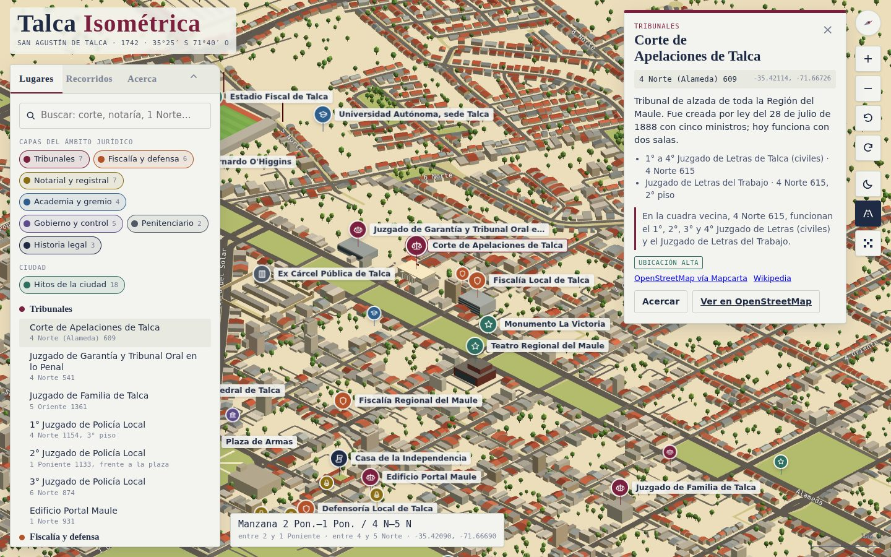

# Talca Isométrica

Maqueta isométrica interactiva de Talca (Región del Maule, Chile) que destaca los lugares del ámbito jurídico (tribunales, fiscalías, defensorías, notarías, registros, academia y la historia legal de la ciudad) junto a sus hitos urbanos. Cubre toda la comuna de Talca (232 km²), recortada por su límite: la ciudad y el campo que la rodea. Está hecha sobre datos reales: las manzanas del Censo 2017 de la comuna y la red vial de OpenStreetMap.

**Verla en línea: [talca.eduramirez.com](https://talca.eduramirez.com/)** · Código: [github.com/eduramirezh/talca-isometrica](https://github.com/eduramirezh/talca-isometrica) · Un proyecto de [Edu Ramírez](https://eduramirez.com/).



- **55 lugares** en 8 categorías, cada uno con dirección y fuente; en los datos (`data/pois.csv`), también sus coordenadas y el nivel de confianza de la ubicación.
- **Dos recorridos guiados:** la Ruta de la Justicia y Talca icónica.
- **~89.000 edificios:** ~3.900 de OpenStreetMap con su planta (todo el centro, y supermercados, colegios, torres y villas en el resto de la comuna), ~67.000 huellas de Microsoft y Google (vía Overture Maps) donde OSM no los tiene, con pisos de Google Open Buildings 2.5D, ~18.000 generados en el navegador frente a cada calle real en los frentes que quedan libres, con alturas según la densidad del censo, y 24 hitos con modelo propio, sobre su planta real.
- **Relieve real** del modelo de elevación Copernicus GLO-30: los cerros del poniente y las terrazas de la ciudad hacia sus ríos, con exageración logarítmica.
- **Vistas:** pixel art (píxeles de 0,5 m con contorno), modo noche, giro de la vista en 90°, tema claro y oscuro, y diseño para móvil.
- **Un solo archivo HTML** autocontenido (~820 KB). Solo carga three.js desde cdnjs y las fuentes de Google Fonts.

## Inicio rápido

No hace falta descargar nada para ver o modificar la página: los datos procesados ya están en `data/`.

```bash
npm install         # una vez: three.js r128, que make build copia a dist/, y ESLint (package.json, versiones fijas)
make build          # -> dist/: index.html y assets/ (el script, three.js y los datos)
make serve          # sirve en http://localhost:8765 y lo abre en el navegador (desde file:// no carga: pide sus datos con fetch)
make check          # revisión rápida (<1 s): JSON, marcadores, hitos, node --check, los archivos que pide la página; make hooks la deja en el pre-commit
make smoke          # carga la página en Chromium y falla si hay errores o la generación sale vacía (~1 min)
```

Para regenerar todo desde las fuentes originales:

```bash
make fetch          # descarga manzanas del Censo, grafo vial OSM y elevación (Copernicus y SRTM) a raw/ (~117 MB, requiere git y curl)
make osm            # la API de OpenStreetMap sobre la comuna: caminos rurales, Ruta 5 y vía (~240 cajas, ~35 MB)
make all            # geometría -> lugares -> HTML
make validate       # compara cada lugar con su dirección en la grilla
```

Requisitos: Python 3.9+ (el pipeline usa solo la biblioteca estándar). Opcionales:

- `pip install -r requirements.txt` para los paneles de diagnóstico y las capturas (o, sin instalar, `uv run tools/x.py`, que lee el encabezado del archivo). Las versiones van fijas y las sube Dependabot (`.github/dependabot.yml`; CLAUDE.md, «Dependencias»); `requirements-geo.txt`, las de `tools/ml_buildings.py` y `tools/sentinel.py`.
- `python -m playwright install chromium` y `npm install` para las capturas sin conexión.

### En Linux

Probado en Linux Mint 22.3 (base Ubuntu 24.04, X11) con una GTX 1650, en noviembre de 2026: la página, las capturas, `make juego` y `make cine`. Lo mismo que en el Mac, con estas diferencias:

- Node, Python, make y ffmpeg de la distribución sirven (`apt install nodejs npm python3 make ffmpeg`); [uv](https://docs.astral.sh/uv/) para las herramientas de `tools/`.
- El Chromium de las capturas, una vez: `uv run --with "playwright==1.63" python -m playwright install chromium-headless-shell` (queda en `~/.cache/ms-playwright/`). En una distribución que no es Ubuntu ni Debian, Playwright avisa y baja la versión de Ubuntu 24.04, que funciona.
- La GPU en las herramientas de Playwright: `--gl gpu` usa la NVIDIA si está su driver propietario, o si no la GPU por omisión por EGL (`--gl nvidia` y `--gl egl` eligen una). La carga del mapa es de la CPU (~14 s con cualquiera), pero dibujar un cuadro de toda la comuna pasa de ~5 s con SwiftShader a 70 ms en una Intel UHD 630 y 15 ms en la GTX 1650: lo notan `video.py` (la usa por omisión), `gif.py` y `perf.py`. `regress.py` y `hitos.py` comparan contra referencias tomadas con SwiftShader: ahí no cambie el `--gl`.
- El juego: Godot 4.7 de [godotengine.org](https://godotengine.org/download/linux/) como `godot` o `godot4` en el PATH (el `Makefile` lo busca ahí; si no, `make juego GODOT=<ruta>`), y para jugar `godot --path juego` (o `make lanzador`, una vez: un ícono en el menú de aplicaciones y en el escritorio). `tools/godot_oculto.sh` lo corre en una pantalla virtual (`apt install xvfb`), sin abrir ventanas ni quitarle el teclado a nadie. Dibuja con la GPU solo con el driver propietario de NVIDIA (Vulkan de Mesa no puede presentar en Xvfb; `GODOT_OCULTO_VK=lavapipe` dibuja por CPU, ~15 veces más lento), y ahí `--fps` mide también la copia a la pantalla virtual.

## Publicar

El sitio [talca.eduramirez.com](https://talca.eduramirez.com/) es `dist/index.html` en Cloudflare Pages (proyecto `talca-isometrica`):

```bash
make deploy DRY_RUN=1   # arma dist/ y lista lo que se subiría, sin subir nada
make deploy             # make build + wrangler pages deploy (el de scripts/deploy/, versión fija; una vez: scripts/deploy/node_modules/.bin/wrangler login)
```

Con `make hooks`, un `git push` que actualiza `main` en `origin` (GitHub) publica solo (`.githooks/pre-push`). Nunca bloquea el push: si la publicación falla, avisa y el push sigue; tampoco publica si hay cambios sin commit. Para saltarlo: `git push --no-verify` o `TALCA_SKIP_DEPLOY=1 git push`.

## Estructura

```
config/
  grid_lines.json        posición de cada calle numerada (revisada a mano; el mapa ya no la usa)
  manzanas.json          manzanas «sin información» del Censo que están construidas, y manzanas con datos que son parques (revisadas en imagen satelital)
  trazados.json          ríos (de OpenStreetMap), vía férrea y Ruta 5, con su procedencia
  usos.json              usos de suelo de los terrenos en blanco del Censo (industria, cementerios, colegios, canchas, eriazos…), con su fuente
  usos-ciren.json        huertos del Catastro Frutícola 2024 de CIREN–ODEPA (especie, año de plantación, conducción)
  usos-censo2024.json    manzanas del Censo 2024 construidas desde 2017 (CC BY-SA 4.0, INE)
  usos-minvu.json        plazas y parques del Catastro Nacional de Áreas Verdes 2023 (MINVU–INE)
  rutas.json             nombres de rutas de OSM que corrige el rol de la Dirección de Vialidad (MOP)
  edificios.json         dónde se dibujan los edificios reales de OpenStreetMap en vez de los generados o junto a ellos (áreas, umbrales de cobertura, correcciones)
  techos.json            la familia del techo (teja, óxido, zinc, claro…) de cada edificio de OSM, clasificada con la imagen satelital
pipeline/
  common.py              rutas, proyección (origen en la Plaza de Armas, grilla girada 5°) y el límite de la comuna (OSM)
  geom.py                geometría compartida: codificación en delta, punto en polígono, segmentos, Douglas–Peucker, Web Mercator
  osm.py, net.py, cli.py los JSON de OSM por id; las descargas (un User-Agent, reintentos); la línea de comandos de cada script
  fetch_sources.sh       descarga las fuentes a raw/ (commits fijados; fuentes.sha256: las sumas de lo que dio los datos de hoy)
  process_geometry.py    manzanas + calles + trazados -> data/geometry.json
  elevation.py           elevación Copernicus GLO-30 -> data/elevation.json (--srtm: la de antes, para comparar)
  geotiff.py             lector de GeoTIFF de elevación (float32, DEFLATE, predictores 1–3) con la biblioteca estándar
  gis.py                 las capas a un GeoPackage y un proyecto de QGIS en metros de grilla (sistema de referencia exacto), y de vuelta los usos editados ahí
  pois.py                catálogo de lugares y recorridos -> data/pois.json + pois.csv
  geocode.py             geocodificador de la numeración de Talca y validador
  grilla.py              el giro de la grilla de una ciudad (el rumbo dominante de sus calles alrededor de la plaza), para otra comuna
  wikidata.py            cruce de los lugares con Wikidata: distancias, fechas, patrimonio y fotos que faltan, candidatos
  build.py               plantilla + datos -> dist/; --where traduce una línea de dist/ a su archivo de src/
  diagnostics.py         paneles PNG para revisar trazados contra las manzanas
  satellite.py           imagen satelital con las manzanas y los usos de suelo encima (qué hay de verdad en cada una); `marco`: la imagen girada al marco local de un hito;
                         --fecha: de cuándo es la imagen; Esri Wayback: --release, `historia` (versiones de una tesela), `tiempo` (una caja en cada captura)
  usos.py                usos de suelo: importación desde OSM, revisión de lo que falta y de config/usos.json
  edificios.py           los edificios de OSM (manzanas enteras y mixtas) y las huellas de aprendizaje automático -> data/edificios.json; panel de cobertura; techos
  golf.py                la imagen de Esri sobre el Talca Country Club -> data/golf.json (pasto cortado y copas)
  fuentes_cl.py          fuentes públicas chilenas (CIREN, CONAF, INE Censo 2024, MINVU, MINEDUC, DEIS): descarga a raw/cl/, lectura y paneles sobre la imagen satelital
  cobertura.py           la cobertura vegetal de CONAF 2024 -> data/cobertura.json (una clase cada 40 m)
  rutas.py               los nombres de las rutas del mapa contra los roles de la Red Vial del MOP
  landmark.py            insumos para modelar un hito: planta OSM, marco local, fotos (Commons por nombre, ubicación o
                         categoría; Panoramax; Mapillary y Flickr con clave)
  mapillary.py           Mapillary: la clave, las fotos de la comuna (teselas vectoriales), qué lugares tienen fotos que los miran
                         y lo que dejan ver de un punto las panorámicas lejanas (mirar);
                         la búsqueda y la elección (una por pasada, de frente) que usa landmark.py photos --mapillary
  traces.py              revisión de trazados contra OSM (cruces, puentes, manzanas en el agua), paneles satelitales, líneas de OSM;
                         la API map de OSM por cajas (tiles, tiles-comuna);
                         cruces, calzadas y ramales de la Ruta 5 -> data/ruta5.json
  sentidos.py            el sentido del tránsito de las calles de un sentido de OSM -> data/sentidos.json (las flechas de los letreros del juego)
  plano.py               las calles, el agua, la vía, la Ruta 5 y la red de calles (planarizada) para los mapas del juego -> juego/datos/plano.json
  railway.py             la vía férrea y el ramal desde OSM: cruces bajo la vía o a nivel, catenaria y señales -> config/trazados.json
src/                     toda la aplicación (CSS, UI y motor three.js r128), en fuentes que build.py une en la página y su script:
  page.html              la página entera: <head>, cargador de los datos (/*DATA*/), DOM, póster y <!--SCRIPTS-->; el marcador /*STYLE*/
  style.css              estilos de la interfaz (tokens de tema en :root)
  js/NN-<sección>.js     el script por secciones (terreno, ciudad, Ruta 5, vía, trenes, usos…), unidas en orden de número
  js/hitos/<id>.js       un hito por archivo, dentro de buildModels (marcador /*HITOS*/ de js/45-landmarks.js)
  js/hitos/ORDER         el orden de los hitos (importa: explanadas vecinas, ayudantes de la plaza)
  site/                  lo que el sitio publicado lleva junto a index.html: favicon.svg, apple-touch-icon.png, og.jpg, los pósters del arranque (poster-movil.webp, poster-escritorio.webp) y _headers (la caché de assets/ en Cloudflare Pages)
data/                    datos procesados (versionados)
.claude/rules/           la guía de Claude Code por tema (CLAUDE.md es el índice); tools/check.py (guide) revisa que sigan calzando
.claude/skills/          procedimientos para Claude Code (modelar-hito)
dist/                    resultado (no versionado: `make build`): index.html, assets/ (app.<hash>.js, three-r128.<hash>.js y un .json con hash por fuente de datos) y los archivos de src/site/
tools/page.py            lo que comparten las herramientas de Playwright: Map (sirve dist/, abre Chromium, espera a window.__idle()), --size --dpr --gl --init, diff()
tools/screenshot.py      capturas con Chromium sin interfaz
tools/variants.py        hoja de comparación: varias vistas por varias variantes de render (--diff: píxeles distintos)
tools/site_assets.py     la imagen de Open Graph, el ícono y los pósters del arranque de src/site/, desde el mapa (make site-assets)
tools/gif.py             un GIF animado para mostrar el mapa: se acerca, gira de día, pasa a la noche y vuelve al comienzo
tools/video.py           el mismo paseo como video vertical de alta calidad para una historia de Instagram (MP4, 1080x1920)
tools/hitos.py           los hitos uno por uno: ms de cada uno y una huella exacta de lo que dibuja y cambia (--save/--against)
tools/probe.py           evalúa expresiones JS en el mapa cargado (window.__rail, __trains…) e imprime el resultado
tools/perf.py            lo que cuesta un cuadro (ms, llamadas de dibujo, triángulos, mapas de sombra, ms de CPU, ms entre cuadros al arrastrar) en varias vistas, y el arranque (--arranque N: ms hasta el primer cuadro; --red, una red móvil emulada; --frio, sin caché); --android en un teléfono por USB
tools/relieve.py         qué mueve un cambio de data/elevation.json: alturas sobre la plaza por zona, matorral por pendiente, puntos de referencia (--png: mapa)
tools/sentinel.py        Sentinel-2 L2A (uv run tools/sentinel.py): escenas sin nubes, recorte en color y NDVI de una caja, usos de suelo que hoy se ven construidos o pelados
tools/regress.py         ¿sale el mismo mapa?: capturas fijas y __stats de referencia (--save) y comparación píxel a píxel (--against)
tools/profile.py         perfil de CPU del arranque: ms por función de src/ (propio, total, --callers), en Chromium o en el teléfono (--android); por etapa (--etapa) y las tareas largas de la segunda (--tareas)
tools/heap.py            la memoria del arranque: el montón de JS por fase (window.__mem), su pico, lo que queda tras un GC y quién asigna o retiene más (MB por función de src/)
tools/lint.py            ESLint sobre el script unido (make lint; reglas en tools/eslint.config.mjs), con el archivo y la línea de src/
scripts/deploy-cloudflare.sh  publica dist/ en Cloudflare Pages (make deploy); .githooks/pre-push lo corre al empujar main
scripts/deploy/          package.json y package-lock.json de Wrangler (versión fija), que deploy-cloudflare.sh instala con npm ci
tools/ml_buildings.py    huellas de edificios de Overture (Microsoft, Google) y alturas de Google 2.5D Temporal -> raw/edificios-ml/, para edificios.py (make edificios-ml)
tools/export.py          la maqueta generada a glTF (Blender, Godot; --teselas: un archivo por tesela, con --instancias, --lejos, --medio y --liviano para el juego) y a STL cerrado para impresión 3D (tools/export.js corre en la página)
tools/blender_ver.py     abre en Blender un glb o STL exportado, con sus colores y encuadrado (-b --png: una vista sin ventana)
tools/icono_juego.py     el ícono del juego (juego/icono.png, pixel art de 32 × 32: la plaza, la torre de la Catedral y el personaje) y, en Linux, su lanzador en el menú y el escritorio (make lanzador)
tools/godot_oculto.sh    corre el juego de Godot lanzado oculto (en el Mac con open -j -g; en Linux en Xvfb), sin quitarle el teclado a quien trabaja: así lo revisan las sesiones de Claude
tools/godot/             proyecto de Godot que carga un glb exportado (ver.gd: cámara ortográfica, colores por vértice; --png); comparar.gd: dos exportaciones de teselas en lo que Godot guarda, vértice por vértice; vitrina.gd: un modelo del juego (peatón, vehículos, autos, árboles) solo, sin el mapa, en cuatro vistas
juego/                   un juego de Godot para pasear por la comuna en tercera persona (make juego exporta juego/mapa/, la comuna en teselas de 500 m; Godot --path juego); juego/modelos/: la plaza, la catedral, las fachadas y las calles de alrededor, y el Edificio Raíces, de cerca
juego/mapa.gd, arboleda.gd   las teselas alrededor de la cámara (en hilos, con los edificios solos hasta 3 km, lo de lejos y la colisión cercana; cuantizado.gd: el formato liviano) y los árboles de la página como los de la plaza; viaje.gd: Tab, ir a un lugar; recorte.gd: los recortes de los modelos sobre cada tesela
juego/autos.gd, faroles.gd   los autos de la página como los de calles.gd (modelos/entorno/auto.gd) de cerca, y los faroles de las calles de noche: postes, brillo y las luces más cercanas
juego/fachadas_ciudad.gd las fachadas de cerca de los edificios de toda la comuna, por tipo (casa antigua, población, pareada, block…), de juego/mapa/f_<i>_<j>.json (tools/export.py --fachadas)
juego/letreros.gd        los letreros con el nombre de las calles en los cruces de la comuna (tools/export.py --letreros): poste, placas con la numeración de la cuadra y la flecha del sentido; el texto, en los más cercanos
juego/vehiculo.gd        la bicicleta, el auto y el jetpack (E: subir o bajar, V: cambiar), con su cámara; pasos.gd: los pasos bajo la Ruta 5 en la colisión
juego/musica.gd          despegar con el jetpack desde el techo de la Torre Talca pone una pista de música (juego/musica/torre-talca.ogg|mp3|wav, fuera de git: la pone cada uno)
juego/vida.gd            la barra de vida, la muerte y la reaparición en la Plaza de Armas, y los carritos de completos de 5 y 6 Oriente, donde se recupera (--dano, --caer)
juego/armas.gd, blancos.gd   el cuchillo, la pistola y el rifle de asalto (1, 2, 3; clic, botón derecho, R; modelos/entorno/armas.gd) y los muñecos de práctica del borde sur de la plaza (--arma, --disparar)
juego/menu.gd            el menú de Esc: pausa, seguir, ir a un lugar, el mapa, volver a la plaza, día o noche, la red local, la ayuda en pantalla, pantalla completa, salir
juego/red.gd             la red local (J): crear una partida o unirse a una en la misma red (ENet; --servidor, --unirse ip|lan, --nombre), con los otros jugadores a pie o en sus vehículos, con sus armas y sus tiros (y el daño que hacen), y en los mapas
juego/bandera.gd         captura la bandera en la red local, para dos o más: cada uno pone su bandera (B), toma las ajenas y anota llevándolas a la suya; el anfitrión la prepara y empieza (J) y decide quién toma y quién anota; al morir se reaparece en la propia
juego/plano.gd, ruta.gd  el mapa en miniatura y el mapa grande (M; plano_datos.gd lee datos/plano.json), y el marcador con el camino por las calles (A*), la cinta de flechas y la columna de luz
juego/trailer.gd         --trailer toma: las tomas del avance (tools/trailer.py las graba con Movie Maker, les pone títulos y música y las junta -> shots/trailer/talca.mp4)
tools/trailer.py         el avance del juego: graba las tomas de juego/trailer.gd, cortes al ritmo, cuadros congelados, títulos y un ritmo sintetizado
juego/cine.gd            --cine: un plano de cine de 30 s en la plaza, de la tarde a la noche (make cine: Movie Maker de Godot y ffmpeg -> shots/cine/plaza.mp4)
juego/vp.gd, juego/vp/   --vp: la plaza en una tele de fondo, proyectada desde la posición de un teléfono Android que filma (WebXR, ARCore; producción virtual como un set de LED)
tools/juego_osm.py       las plantas y los nodos de la calle de OSM alrededor de la plaza para juego/modelos/ y la página (data/plaza-osm.json)
juego/modelos/plaza.gd   la Plaza de Armas del juego en detalle (árboles, quiosco, piletas, faroles, escaños; plaza/: árboles, piezas y texturas en código)
juego/modelos/raices.gd  el Edificio Raíces (3 Oriente 1645) de cerca: balcones con baranda de vidrio, ventanas hundidas, hall, azoteas, jardín y reja; se arma cuando llega su tesela
juego/malla.gd, materiales.gd   el constructor de mallas y los materiales de todos los modelos del juego (shaders/: capa, patron, plaza/)
juego/args.gd, fps.gd, glb.gd   las banderas de la línea de comandos, el arnés de --fps y lo que tools/export.py escribe en juego/mapa/indice.json (capas, luces, lugares, teselas)
tools/check.py           revisión rápida del repo (make check), con las trampas de config/ y data/ que se pueden comprobar; .githooks/pre-commit la corre antes de cada commit (make hooks)
tools/datadiff.py        qué cambió en los data/*.json (de una línea): claves, tamaños y elementos distintos contra HEAD u otra versión
tests/                   pruebas del pipeline que corre make check (test_pipeline.py: huellas en Python y en la plantilla, geometría, línea de comandos) y golden.py (make golden: la salida de cada comando del pipeline, antes y después de un cambio)
docs/                    metodología, fuentes, investigación de proyectos similares
```

## Correcciones y contribuciones

¿Un lugar mal ubicado, una dirección vieja, un dato que no calza? Use «Reportar un error en este lugar» en su ficha, que abre un [issue en GitHub](https://github.com/eduramirezh/talca-isometrica/issues) con el lugar ya escrito, o abra uno a mano con el lugar (su nombre o el `#id` de su enlace), qué está mal y una fuente: una página oficial, una foto fechada o el objeto de OpenStreetMap. Las correcciones de OSM conviene hacerlas también en [OpenStreetMap](https://www.openstreetmap.org), de donde salen calles, ríos y plantas.

Los cambios de código o de datos se reciben como pull request en GitHub. Antes de enviarlo: `make hooks` una vez (deja `make check` antes de cada commit) y, si el cambio se ve, una captura con `tools/screenshot.py`. Los lugares van en `pipeline/pois.py` con fuente y confianza honesta, y los textos en español de Chile; las convenciones y las trampas conocidas están en [CLAUDE.md](CLAUDE.md) y [docs/METODOLOGIA.md](docs/METODOLOGIA.md).

## Documentación

- [docs/METODOLOGIA.md](docs/METODOLOGIA.md): cómo se construyó, paso a paso, con las decisiones y lo que es aproximado.
- [docs/ESTETICA.md](docs/ESTETICA.md): criterios visuales de los hitos hechos a mano (pixel art, paleta, revisión).
- [docs/FUENTES.md](docs/FUENTES.md): fuentes de datos, licencias y atribuciones.
- [docs/PROYECTOS-SIMILARES.md](docs/PROYECTOS-SIMILARES.md): Isopolis, Isometric NYC y las ideas que se tomaron de ellos.
- [docs/PLAN-TREN.md](docs/PLAN-TREN.md): la vía férrea completa y sus puentes (hechos) y el plan del tren en movimiento.
- [docs/PLAN-SITIO.md](docs/PLAN-SITIO.md): el sitio sin las restricciones del artifact de Claude: datos aparte y three.js propio (hechos); empaquetador, Worker, primera vista generada al armar, three.js nuevo y relieve más fino.
- [docs/PLAN-COMUNAS.md](docs/PLAN-COMUNAS.md): qué de Talca está fijo en el código y un plan para hacer la maqueta de otra comuna (Curicó como prueba).
- [CLAUDE.md](CLAUDE.md): guía para seguir trabajando con Claude Code. Corta, porque se carga en cada sesión: lo que vale para todo el repo, la arquitectura en una tabla y el índice de las trampas conocidas.
- [.claude/rules/](.claude/rules/): el detalle de la guía, un archivo por tema (la generación, los hitos, la ciudad, los edificios, los usos de suelo, ríos y vías, el pipeline, la página, el juego, las herramientas), con sus comandos y sus trampas. Claude Code carga cada uno al tocar los archivos de su `paths:`; para una persona, son la referencia de cada parte.
- [.claude/skills/modelar-hito/](.claude/skills/modelar-hito/SKILL.md): el procedimiento para modelar un hito, paso a paso (`/modelar-hito` en Claude Code).
- [docs/PENDIENTES.md](docs/PENDIENTES.md): ideas pendientes, con lo medido y lo probado.
- [CHANGELOG.md](CHANGELOG.md): cambios.

## Licencia

- **Código y modelos de los hitos** (`pipeline/`, `tools/`, `src/`, incluidos los hitos hechos a mano de `src/js/hitos/`): licencia MIT, en [LICENSE](LICENSE).
- **Datos derivados de OpenStreetMap** (`data/geometry.json`, `data/ruta5.json`, `data/sentidos.json`, `data/edificios.json` y las partes de OSM de `config/trazados.json`, `config/usos.json` y las coordenadas de los lugares): ODbL 1.0, © colaboradores de OpenStreetMap, en [LICENSE-DATA](LICENSE-DATA). Toda publicación debe mantener la atribución (está en la pestaña «Acerca»).
- **Textos de las fichas y de `docs/`:** obra propia de Edu Ramírez; se pueden citar con atribución (ver [LICENSE-DATA](LICENSE-DATA)).
- **Huellas de edificios de aprendizaje automático** (en `data/edificios.json`): Microsoft y Google vía Overture Maps Foundation, ODbL 1.0; alturas de Google Open Buildings 2.5D Temporal (elegida bajo ODbL; contiene datos modificados de Copernicus Sentinel-2). Ver [LICENSE-DATA](LICENSE-DATA).
- **Manzanas:** Censo de Población y Vivienda 2017, Instituto Nacional de Estadísticas de Chile; las construidas desde 2017 (`config/usos-censo2024.json`), del Censo 2024 del INE, bajo CC BY-SA 4.0.
- **Relieve** (`data/elevation.json`): producido con Copernicus WorldDEM-30 © DLR e.V. 2010-2014 y © Airbus Defence and Space GmbH 2014-2018, provisto bajo COPERNICUS por la Unión Europea y la ESA; aviso y frase de responsabilidad en [LICENSE-DATA](LICENSE-DATA).
- **Huertos, cobertura vegetal y plazas:** CIREN–ODEPA (`config/usos-ciren.json`), CONAF (`data/cobertura.json`) y MINVU–INE (`config/usos-minvu.json`), información pública del Estado; ver [LICENSE-DATA](LICENSE-DATA).
- **Imagen satelital:** las teselas de Esri World Imagery que baja `pipeline/satellite.py` se usan solo para revisar a mano; nada de ellas se redistribuye.

Cada fuente, su licencia y para qué se usó: [docs/FUENTES.md](docs/FUENTES.md).
