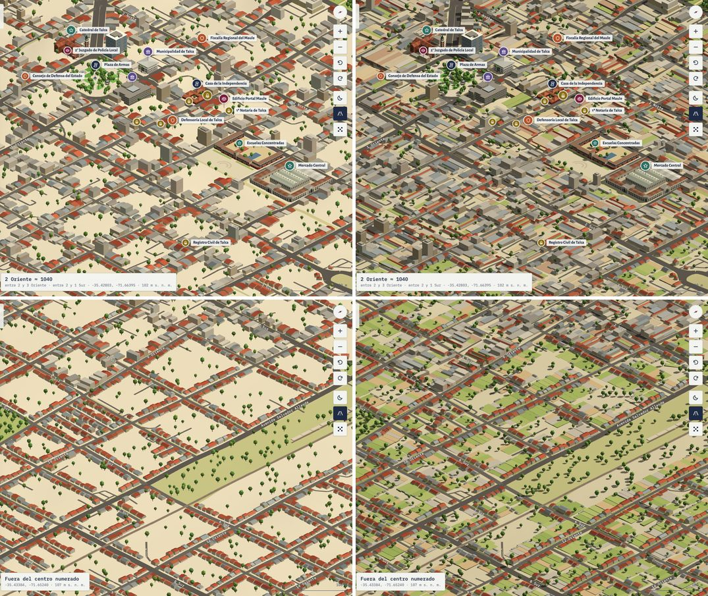
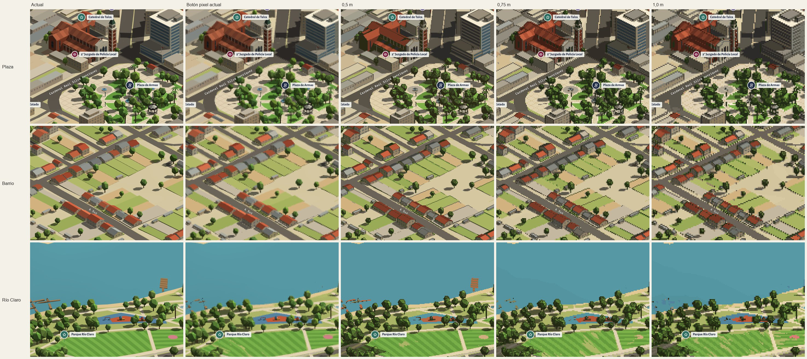
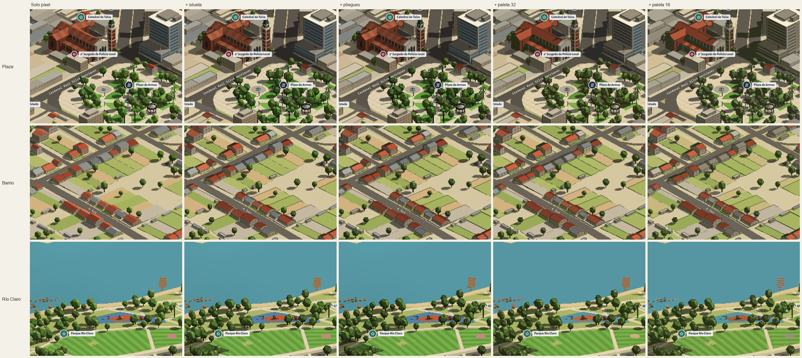
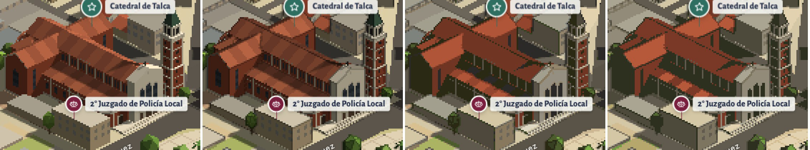

# Proyectos similares e ideas tomadas

Investigación hecha antes de construir la maqueta (septiembre de 2026).

## Isopolis San Francisco (Vivek Aithal, @nuwandavek)

Es el «mapa isométrico de San Francisco con lugares del mundo tech».

- **Enlaces.** Sitio: https://sf.isopolis.city/. Notas técnicas del autor: https://sf.isopolis.city/dev.html. Hacker News: [«Show HN: Isopolis»](https://news.ycombinator.com/item?id=49149966), 350 puntos, agosto de 2026.
- **Cómo se hizo.**
  - Google Photorealistic 3D Tiles renderizados en three.js con cámara ortográfica fija (azimut 22,5°, elevación 30°), capturados con Playwright.
  - Arte de referencia con Nano Banana y un ajuste fino LoRA de Qwen-Image-Edit para convertir las capturas a pixel art.
  - Visor propio en canvas, con un mapa base CARTO deformado debajo.
- **Funciones.** Capa GeoJSON de letreros, «monedas» de empresas, barrios con hover y clic, recorridos guiados, postales para compartir, música y efectos.
- **Críticas.** Errores de la IA (calles convertidas en ríos, sombras tomadas por lagos), píxeles borrosos y una ciudad plana.

## Isometric NYC (Andy Coenen)

- **Enlaces.** https://isometric.nyc. Explicación: https://cannoneyed.com/projects/isometric-nyc. Hacker News: [1.325 puntos](https://news.ycombinator.com/item?id=46721802).
- **Cómo se hizo.** Google 3D Tiles con render ortográfico, Qwen-Image-Edit ajustado con unos 40 pares de imágenes y un visor de zoom profundo (OpenSeadragon).
- **Lo que pidieron los usuarios.** Enlaces a coordenadas, nombres de calles, rotación de 90° y agua animada.

## Otros

- [Google Maps Mania: Isometric San Francisco](https://googlemapsmania.blogspot.com/2026/08/isometric-san-francisco.html)
- **sf.thijs.gg** («SF as a video game»): Gaussian splats; criticado por su consumo de memoria.
- **isocity**, de victorqribeiro: un constructor de ciudades en canvas puro que guarda el estado en la URL.
- **Streets GL**: render 3D de OSM con ciclo de día y noche.
- **IsometricBlocks**, de Shaun Lebron: orden de dibujo de cajas isométricas.

## Qué se tomó y qué se hizo distinto

| Idea | En Talca Isométrica |
|---|---|
| Vista fija de simulador | Cámara ortográfica 2:1 (elevación 30°), con giro de 90° (lo pidieron los usuarios de NYC) |
| «Monedas» de empresas | Monedas por institución, con ícono y color por categoría y filtros por capa |
| Recorridos guiados | Ruta de la Justicia y Talca icónica, con progreso y anterior/siguiente |
| Enlaces a un punto | `#id` por lugar o recorrido (la plataforma solo admite un identificador simple) |
| Nombres de calles | Etiquetas giradas según la calle, con interruptor y sin superposiciones |
| Edición de nieve y noche | Modo noche con ventanas y faroles; pixel art siempre activo, con píxeles de 0,5 m |
| Imágenes de IA | **No.** Geometría real dibujada en el navegador, para que calles y manzanas estén donde corresponden y se evite el aspecto difuso de la IA |
| Página de créditos honesta | Pestaña «Acerca» con fuentes y limitaciones, más esta documentación |

## Qué falta para parecerse a Isopolis e Isometric NYC (octubre de 2026)

Comparación hecha con capturas de la maqueta (vista inicial, zoom 3 y modo pixel) frente a las dos referencias. Las dos son imágenes generadas con IA desde Google 3D Tiles, así que su método no sirve aquí (ver la tabla anterior). Pero lo que hace que se lean como un juego de ciudades son unos pocos rasgos visuales, y esos se pueden reproducir con geometría y shaders.

| # | Rasgo de las referencias | La maqueta antes | Qué hacer | Estado |
|---|---|---|---|---|
| 1 | **Ciudad llena.** Techos, patios y pavimento de borde a borde; casi no se ve suelo pelado. | Manzanas color arena con cajas sueltas encima: en `cityGen()` las casas tenían antejardín de 2,5–4 m, 1–4 m entre ellas y 8–12 m de fondo, y el resto de la manzana quedaba del color del suelo. | Cada casa sobre su lote completo (antejardín, pasillo lateral y patio hasta el medio de la manzana); en el centro, casas de patio y construcciones al fondo. | Hecho |
| 2 | **Luz de juego de ciudades.** Tres tonos por caja (techo claro, muro al sol, muro a la sombra) y sombras proyectadas nítidas. | Cielo y sol a 0,62 cada uno, sin sombras: todas las caras casi igual de claras. | Sol más fuerte que el cielo y sombras de sol. | Hecho |
| 3 | **Pixel art de verdad.** Píxeles de tamaño fijo, contorno de un píxel, paleta limitada. | El botón pixel solo baja la resolución a 0,34: el tamaño del píxel cambia con el zoom y las casas quedan en 3–4 píxeles borrosos. | Píxel de tamaño fijo en metros (~0,5 m) con escalado entero; contorno de un píxel en un tono más oscuro de cada cara, donde cambian la profundidad o la normal; reducción a una paleta. | Hecho: es el único modo, con píxeles de 0,5 m, contorno y sin paleta (abajo). ESTETICA §1 se ajustó: el contorno es el único posproceso. |
| 4 | **Detalle al nivel de la calle.** Veredas con solera, pasos de cebra, autos estacionados, hileras de árboles de vereda; techos con objetos (calefones solares, claraboyas, salidas de escalera); árboles como matas sombreadas. | Calles como cintas grises; árboles como puntos sueltos, que en la vista general se leen como ruido sobre potreros y cerros. | Veredas y autos en `buildBase()`/`cityGen()`; objetos de techo en los lotes; árboles en grupos. | Pendiente |
| 5 | **Agua con textura.** Una línea clara de un píxel en la orilla y un patrón de ondas ralo. | Azul plano. | En el material del agua (`matWater`). | Pendiente |
| 6 | **Color.** Isopolis es cálido y saturado (su autor lo llama inspirado en Ghibli). | Paleta desteñida a propósito (METODOLOGIA §10). | Un poco más de saturación y contraste, sin perder el «Maule en verano». | Pendiente |

Lo que no se copia: el proceso con IA y sus errores (calles convertidas en ríos, sombras tomadas por lagos, la crítica más repetida a ambos mapas). Se quedan los bordes del diorama, el giro de 90° y la geometría real.

### Lo hecho: ciudad llena y luz (1 y 2)

**Lotes.** Cada casa de `cityGen()` está sobre su lote: una losa 20 cm sobre el suelo, del color de su patio, que va del antejardín al fondo e incluye el pasillo lateral. El fondo llega hasta el medio de la manzana medido detrás del lote, así que los lotes de dos calles opuestas se juntan espalda con espalda, como en las manzanas reales. Si no cabe, el patio se acorta en cuartos y, como último recurso, la casa queda sin lote.
- **Barrios (`house`):** pasto, tierra o cemento; casi la mitad de los patios tiene una mediagua al fondo y algunos un árbol.
- **Centro (`core`):** la casa de un piso es colonial, con la crujía a la calle y un ala de teja a un costado del patio (a veces también al fondo, en U). En los lotes comerciales, una bodega o un bloque de uno o dos pisos cubre la mitad o más del fondo. Patios de piedra, baldosa, cemento o jardín.
- **Lotes exactos.** Los lotes se prueban entre sí como rectángulos (`LOTS`, `sepQuad`), no con el raster de 2,5 m, que dejaba franjas entre vecinos o permitía que dos losas se montaran y parpadearan. En `occ` los lotes valen 2; las pruebas de `cityGen` solo ven el valor 1, que es lo que había antes (hitos, ríos, Ruta 5, vía férrea).
- **Efectos.** Hay menos edificios (56.834 contra 71.860) porque cada lote reserva su patio y la prueba ya no tolera superposiciones, pero la superficie construida o cubierta es mucho mayor. La generación tarda ~0,7 s más (2,0 s en las capturas).

**Luz y sombras.**
- **El sol.** Viene del nor-nororiente a 45° de altura, con intensidad 0,82 contra 0,5 del cielo. Desde la vista inicial (desde el sureste) el muro oriente queda al sol, el sur a la sombra y las sombras caen delante de este, donde se ven. Antes el sol venía del nororiente y a 55°: las sombras caían detrás de los edificios y casi no se veían.
- **Qué proyecta sombra.** Los edificios, los hitos, el santuario del Cerro y los árboles. Las reciben todas las mallas; de noche se apagan.
- **La cámara de sombras.** Un mapa PCF de 4096² (2048² en móvil). `fitShadow()` lo ajusta en cada `placeCam()` al suelo que se ve, más 400 m hacia el sol, y lo mueve en texeles enteros para que los bordes no titilen al desplazar la vista.

### El pixel art (punto 3)

Se probó primero como vista previa, fuera de la interfaz: `window.__pixelArt({m, outline, palette})` dibuja la escena con píxeles de arte de unos `m` metros (0,5 por omisión; `k`, los píxeles de pantalla por píxel de arte, sigue al zoom y a la densidad de la pantalla; `{k}` lo fija), a 1/k de la pantalla en un objetivo con profundidad, dibuja sus normales en una segunda pasada (desde octubre de 2026 salen de la profundidad, sin esa pasada) y la muestra con cada píxel de k × k. `outline: 1` oscurece el píxel de una superficie cuyo vecino está más de `edge` metros más lejos (la silueta, de un píxel, en un tono más oscuro del color de la superficie); `outline: 2` agrega los pliegues, donde gira la normal a la misma profundidad (cumbreras, esquinas). `palette: n` reduce el cuadro a n colores hallados en él (k-means). `__pixelArt(null)` lo apaga. Las hojas se hicieron con `tools/variants.py`, a zoom 14,2: un píxel de 0,5 m con k = 2.

Lo que muestran:
- **El contorno es lo que más aporta.** La silueta y los pliegues dibujan cumbreras, aleros y esquinas como en un juego de ciudades; los techos de las casas se leen como piezas.
- **El píxel de 0,5 m conserva los hitos.** A 0,75 m todavía se leen los barrios; a 1,0 m se pierden las ventanas de la Catedral y las diagonales se vuelven escaleras gruesas. Pero 0,5 m por píxel es un zoom mucho más cercano que el de la ficha (~0,9 m por píxel de pantalla): a ese zoom, un píxel de arte de k = 2 mide 1,8 m y una casa ocupa unos 5. El modo pixel necesitaría sus propios niveles de zoom, como los visores de las referencias.
- **La paleta automática empeora.** Ajustada al cuadro entero, tiene pocos rojos: el ladrillo de la Catedral se vuelve oliva oscuro y se pierden los paños del techo y las ventanas; en el prado aparecen manchas. Si se quiere paleta, tiene que ser curada (ESTETICA §4 y los tonos que da la luz), no calculada. Sin ella, los colores de la escena ya son planos.
- **Las superficies grandes siguen lisas.** El agua y los prados no ganan textura con el píxel: eso es el punto 5.
- **No resuelto en la vista previa:** el titileo de los píxeles al desplazar la vista (habría que mover la cámara en píxeles de arte enteros), la noche, el móvil y el zoom en pasos enteros.

**Decisión (octubre de 2026).** El píxel de 0,5 m con contorno es el único modo: se quitó el botón pixel, que solo bajaba la resolución. Se ajustó lo que la vista previa no resolvía:
- **El titileo.** La imagen de baja resolución está anclada al origen de la grilla (la cámara se corre una fracción de píxel de arte y la pasada de pantalla la devuelve), así que al desplazar la vista los píxeles se mueven enteros.
- **El zoom.** k (píxeles de pantalla por píxel de arte) sigue al zoom y a la densidad de la pantalla. Más lejos que ~0,5 m por píxel de pantalla, k es 1 y el contorno se aligera: pliegues hasta 1 m, silueta hasta 2 m, nada más allá. Con contorno en la vista inicial, cada árbol lejano era un punto oscuro.
- **La noche.** Los faroles se dibujan a 1/k de su tamaño para que el resplandor no crezca.
- **La paleta.** Sin paleta: la automática estropeaba los colores, y una curada queda como idea.
- **Lo que no se cambió.** Los niveles de zoom siguen siendo continuos.
